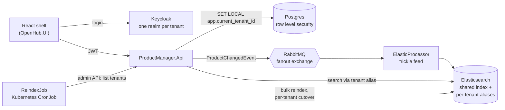

# OpenHub

Project homepage: [openhubcrm.com](https://openhubcrm.com)

A personal open-source project, independent of any employer.

OpenHub is a multi-tenant internal platform: a role-gated React shell in front of a set of .NET backend services, isolated per tenant via Keycloak realms, Postgres Row Level Security, and (for search) per-tenant Elasticsearch aliases. **Product Manager** — a multi-tenant product catalog with full-text search — is the first module built out end to end; Help Desk, Ordering, and CRM are placeholders in the UI shell today.

Day-to-day local development runs entirely through **.NET Aspire** (one `dotnet run` spins up every dependency — Postgres, Redis, RabbitMQ, Elasticsearch, Keycloak, Consul, Vault — plus every service, pre-wired). The raw Kubernetes manifests under `infrastructure/k8s/` are the production-style path: standing up the same dependencies by hand on a local Docker Desktop Kubernetes cluster, useful for testing deployment workflows without Aspire in the loop.

---

## Table of Contents

1. [Architecture](#architecture)
2. [Solution Layout](#solution-layout)
3. [Quick Start: Local Development with Aspire](#quick-start--local-development-with-aspire)
4. [Product Catalog: Multi-Tenancy & Search Architecture](#product-catalog-multi-tenancy--search-architecture)
5. [Design Decisions](#design-decisions)
6. [Kubernetes Deployment Path](#kubernetes-deployment-path)
7. [Roadmap](#roadmap)
8. [License](#license)

---

## Architecture

The Product Manager module end to end: a request is authenticated against the tenant's Keycloak realm, written to Postgres under row level security, and published as an event that keeps the Elasticsearch index in sync. A scheduled job rebuilds the index in full.



---

## Solution Layout

Every backend project lives under `src/` and follows [iDesign layering](https://www.idesign.net/) (Controllers → Managers → Engines → Accessors) where applicable. Each has its own README with details — this table is the map.

| Project | Purpose |
|---|---|
| [`OpenHub.UI`](src/Shell/OpenHub.UI) | React shell: Keycloak login, role-gated dashboard tiles, one lazy-loaded module per business area (Product Management, Help Desk, Ordering, CRM). |
| [`OpenHub.Platform.AppHost`](src/Platform/OpenHub.Platform.AppHost) | .NET Aspire orchestrator for local dev — wires up every dependency and service below with service discovery, health checks, and seeded dev config/secrets. |
| [`OpenHub.Platform.ServiceDefaults`](src/Platform/OpenHub.Platform.ServiceDefaults) | Shared cross-cutting concerns every service opts into: OpenTelemetry, health checks, Consul/Vault config loading, multi-realm Keycloak JWT auth. |
| [`OpenHub.Accessor.KeyCloak`](src/Accessor/OpenHub.Accessor.KeyCloak) | Multi-realm Keycloak client: realm/admin API access and M2M (client-credentials) token issuance, cached per realm. |
| [`OpenHub.Accessor.RabbitMq`](src/Accessor/OpenHub.Accessor.RabbitMq) | Durable fanout-exchange publisher, pooled channels, built for high-concurrency publish from a singleton. |
| [`OpenHub.Accessor.ElasticIndex`](src/Accessor/OpenHub.Accessor.ElasticIndex) | Generic tenant-isolated Elasticsearch indexing: one shared index per document type, per-tenant filtered aliases + scoped API keys, plus versioned-index/bulk/alias-repoint support for full reindexes. |
| [`OpenHub.ProductManager.Contracts`](src/ProductManager/OpenHub.ProductManager.Contracts) | Shared wire contracts (events, Elasticsearch document shapes) between the Product Manager API and its downstream consumers — no drift between publisher and consumer. |
| [`OpenHub.ProductManager.Api`](src/ProductManager/OpenHub.ProductManager.Api) | The product catalog API: multi-tenant CRUD, lookups, paged/full-text search, admin (cross-tenant) endpoints. Publishes `ProductChangedEvent`s on every write. |
| [`OpenHub.ProductManager.ElasticProcessor`](src/ProductManager/OpenHub.ProductManager.ElasticProcessor) | Trickle-feed consumer: reacts to `ProductChangedEvent`s in near-real-time, keeping the Elasticsearch index in sync one product at a time. |
| [`OpenHub.ProductManager.ReindexJob`](src/ProductManager/OpenHub.ProductManager.ReindexJob) | One-shot scheduled job (Kubernetes CronJob in prod): rebuilds the entire Elasticsearch index from scratch, tenant by tenant, with independent per-tenant cutover. |
| [`OpenHub.ProductManager.SeedTool`](src/ProductManager/OpenHub.ProductManager.SeedTool) | Console tool for bulk-loading realistic catalog data directly via Postgres `COPY`, for load-testing the sync/search path without going through the API. |
| `src/Database/ProductManager` | Flyway SQL migrations for the catalog schema, Row Level Security policies, and reference data. |
| `infrastructure/k8s` | Raw Kubernetes manifests for every stateful/infra dependency (Postgres, RabbitMQ, Redis, Consul, Vault, Kong, and the Product Manager reindex CronJob) — the non-Aspire deployment path. |

---

---

## Quick Start — Local Development with Aspire

This is the recommended day-to-day workflow — one command starts Postgres, Redis, RabbitMQ, Elasticsearch, Keycloak, Consul, Vault, Flyway migrations, the React shell, and every backend service, all wired together with real service discovery.

**Prerequisites:**
- .NET SDK 10.0+ (`dotnet --version`)
- .NET Aspire workload (`dotnet workload install aspire`)
- Docker Desktop (containers only — Kubernetes does not need to be enabled for this path)
- Node.js (for the Vite-based React shell)

**Run it:**
```powershell
cd src
dotnet run --project Platform/OpenHub.Platform.AppHost
```

The Aspire dashboard (URL printed on startup) shows every resource, its logs, traces, and health. Notable pieces:

- **Two dev tenant realms** (`client-a`, `client-b`) are imported into Keycloak automatically — the React shell defaults to `client-a`.
- **Flyway** runs catalog migrations against Postgres before the API starts.
- **Consul/Vault "seed" containers** populate dev config and secrets on every run — without them, `AddConsulConfiguration`/`AddVaultSecrets` silently no-op.
- **`product-manager-reindex-job`** is registered with `.WithExplicitStart()` — it's a one-shot job, not a long-running service, so it won't auto-start with everything else. Trigger a manual run from the Aspire dashboard when you want to exercise a full reindex locally.

See each project's own README (linked in [Solution Layout](#solution-layout)) for standalone (non-Aspire) run instructions, environment variables, and Docker build/run commands.

---

---

## Product Catalog: Multi-Tenancy & Search Architecture

The Product Manager module is the reference implementation for how every OpenHub module should handle multi-tenancy:

- **Tenant isolation in Postgres** — every tenant-owned table has `FORCE ROW LEVEL SECURITY`, keyed on a `SET LOCAL app.current_tenant_id` session variable the API sets per request. `catalog.tenants` itself is deliberately excluded (it's managed above the tenant boundary).
- **Tenant isolation in auth** — each tenant is its own Keycloak realm; a single API instance serves all tenants by resolving the realm dynamically from the JWT's `iss` claim (`TenantMiddleware`). M2M (service-to-service) calls use per-realm client-credentials tokens.
- **Tenant isolation in search** — a single shared Elasticsearch index (`products`) with a per-tenant *filtered alias* (`products-tenant-{tenantId}`) and a per-tenant API key whose role descriptor is restricted to only that alias. Enforced at the Elasticsearch layer itself, not by application-level trust.
- **Two ways the index stays up to date:**
  - **Trickle feed** (`OpenHub.ProductManager.ElasticProcessor`) — every product create/update/delete publishes a `ProductChangedEvent` to a RabbitMQ fanout exchange; a consumer reindexes that one product in near-real-time.
  - **Scheduled full reindex** (`OpenHub.ProductManager.ReindexJob`) — a Kubernetes CronJob rebuilds the whole index from scratch on a schedule, writing into a new versioned index via Elasticsearch's Bulk API and cutting each tenant's alias over independently as soon as that tenant's data finishes writing — a slow or huge tenant never blocks anyone else's cutover. It deliberately does **not** reuse the trickle-feed queue (bulk writes have a very different throughput profile than one-message-per-product), and cleans up superseded indices only once a full run succeeds for every tenant.
- A new cross-tenant **admin API** (`GET /api/v1/admin/tenants`, gated by a separate `AdminScope` Keycloak client/policy) exists specifically so the reindex job can enumerate tenants without needing a privileged per-tenant token.

---

---

## Design Decisions

- **Isolation is enforced below the application.** Postgres uses `FORCE ROW LEVEL SECURITY` and Elasticsearch uses per-tenant filtered aliases with API keys limited to that alias, so a bug in application code cannot leak across tenants.
- **One API instance serves every tenant.** The tenant's Keycloak realm is resolved from the JWT `iss` claim, and service-to-service calls use per-realm client-credentials tokens.
- **Two ways to keep search current.** A trickle feed handles single-product changes in near real time. A scheduled full reindex repairs drift. The reindex job deliberately does not reuse the trickle-feed queue, because bulk writes have a very different throughput profile.
- **Per-tenant cutover.** Each tenant's alias moves to the new index as soon as its own data finishes, so one slow tenant never blocks the others. Old indices are removed only after a run succeeds for every tenant.
- **A separate admin scope.** A cross-tenant admin endpoint, gated by its own Keycloak client and policy, lets the reindex job list tenants without holding a privileged per-tenant token.
- **Shared contracts.** Events and Elasticsearch document shapes live in one `Contracts` project, so publishers and consumers cannot drift apart.
- **iDesign layering** (Controllers, Managers, Engines, Accessors) keeps each service's responsibilities explicit.

---

## Kubernetes Deployment Path

Local development runs through Aspire. For production-style testing, the raw manifests under `infrastructure/k8s/` stand up the same dependencies by hand on a local Docker Desktop Kubernetes cluster. The step-by-step guide, including Vault bootstrap and testing GitHub Actions workflows locally with `act`, is in [docs/kubernetes-bootstrap.md](docs/kubernetes-bootstrap.md).

---

## Roadmap

| Module | Status |
|---|---|
| Product Manager (catalog, multi-tenant search) | Built end to end |
| Help Desk | Placeholder in the UI shell |
| Ordering | Placeholder in the UI shell |
| CRM | Placeholder in the UI shell |

---

## License

See [LICENSE](LICENSE) for details.
